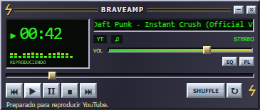
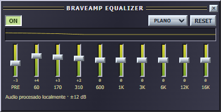
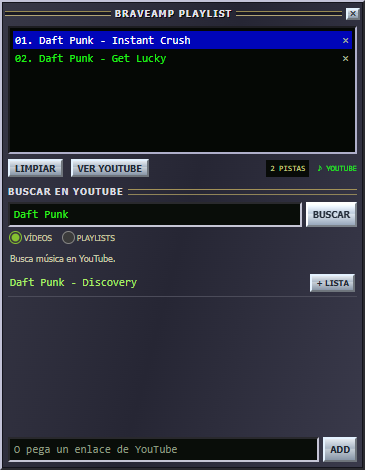
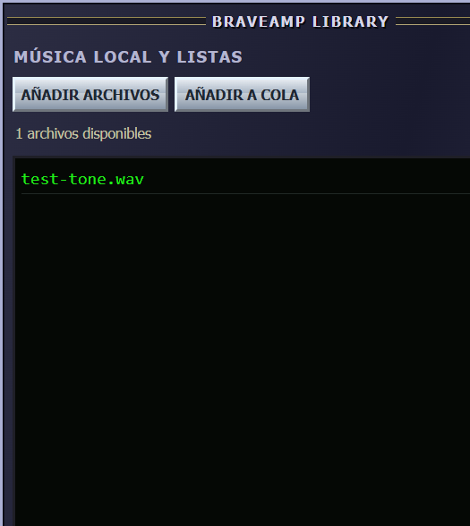

# MusicCraft

<p align="center"></p>

<p align="center"><strong>Tu música, con el aspecto clásico de los reproductores de siempre.</strong></p>

MusicCraft es un reproductor gratuito y experimental inspirado en Winamp. Reúne música local, búsqueda de canciones y listas online, ecualizador y cola de reproducción en una interfaz clásica. El proyecto no incorpora publicidad propia.

> MusicCraft es independiente; no está afiliado a Winamp, ArtCraft, Brave ni YouTube. La reproducción online utiliza YouTube. El filtrado está basado en componentes y reglas de Brave, pero no integra el navegador Brave completo ni garantiza bloquear todos los anuncios.

## Descargas

| Plataforma | Estado | Descarga |
| --- | --- | --- |
| Android | Versión experimental firmada; Android 8 o superior, ARM64 o x86-64. | [Descargar APK 0.15](https://github.com/AdolfoCasMar/MusicCraft/releases/download/android-v0.15/MusicCraft-Android-0.15.apk) |
| Windows | Versión experimental para Windows de 64 bits; necesita Microsoft Edge WebView2 Runtime. | [Descargar versión 0.8.4](https://github.com/AdolfoCasMar/MusicCraft/releases/download/windows-v0.8.4/MusicCraft-Windows-0.8.4.exe) |
| iPhone | Prototipo inicial, sin búsqueda online ni filtrado; requiere firma para instalarlo. | [Consultar el proyecto iOS](mobile/ios/README.md) |
| Linux | Prueba temprana para x86-64; requiere GTK 3, WebKitGTK 4.1 y X11 o XWayland. | [Descargar Linux alpha 0.8.4](https://github.com/AdolfoCasMar/MusicCraft/raw/refs/heads/main/downloads/MusicCraft-Linux-alpha-0.8.4-x64.tar.gz) |
| macOS | Prueba temprana para Apple Silicon; aplicación sin firmar. | [Descargar macOS alpha 0.8.4](https://github.com/AdolfoCasMar/MusicCraft/raw/refs/heads/main/downloads/MusicCraft-macOS-alpha-0.8.4-arm64.zip) |

[Ver todas las versiones](https://github.com/AdolfoCasMar/MusicCraft/releases).

Las versiones de Linux y macOS todavía no son equivalentes a la de Windows: el filtrado de peticiones de red no está integrado y puede aparecer publicidad. Linux se ha comprobado arrancando en un entorno virtual; macOS se ha compilado, pero no se ha probado su funcionamiento en un Mac. La reproducción y las ventanas necesitan más pruebas en ambos sistemas.

**Actualización de Android:** los APK 0.13, 0.14 y 0.15 están firmados con la misma clave. Si se procede de una versión anterior con la firma de prueba, puede ser necesario desinstalarla, lo que puede borrar sus ajustes y playlists. Android o el fabricante pueden mostrar avisos al instalar aplicaciones de fuera de una tienda.

## Funciones

- Interfaz clásica con reproductor, ecualizador, cola de reproducción y biblioteca.
- Música local, búsqueda online y listas guardadas; la disponibilidad de contenido depende del servicio de origen.
- En Windows, módulos que pueden moverse, acoplarse y plegarse. En Android, módulos plegables y reordenables.
- En Android, controles multimedia y reproducción en segundo plano; el comportamiento puede variar según el teléfono.
- Visualizador de frecuencias en Android para archivos locales y fuentes online compatibles.
- Pausa durante llamadas telefónicas en Android: se ha probado con una llamada simulada y música local; falta probarla en teléfonos reales y con fuentes online.
- Comprobación de versiones publicadas en GitHub y acceso a la página de descargas; la instalación es manual. En las versiones alpha de Linux y macOS la detección necesita que se publiquen lanzamientos compatibles.

## Imágenes

Estas capturas son de una versión anterior de escritorio y pueden mostrar el nombre anterior y controles diferentes.

| Reproductor | Ecualizador |
| --- | --- |
|  |  |

| Lista de reproducción | Biblioteca |
| --- | --- |
|  |  |

## Privacidad y permisos en Android

Para abrir música local, MusicCraft usa el selector de archivos de Android y accede a los archivos elegidos, sin pedir acceso general al almacenamiento. La pausa en llamadas solicita permiso para conocer el estado del teléfono; no solicita el historial ni los números. También utiliza acceso a Internet y un servicio de reproducción en segundo plano. Algunas funciones y controles pueden variar entre dispositivos.

## Desarrollo

El escritorio usa Rust y Tao, con WebView2 en Windows y WebKit en las pruebas de Linux y macOS. La versión Android utiliza Java, JavaScript/Web Audio y el motor de filtrado en Rust. Consulta [Android](mobile/android/README.md) y [iOS](mobile/ios/README.md) para instrucciones y limitaciones. Para compilar Windows se necesitan Rust, herramientas C++ de Visual Studio y Microsoft Edge WebView2 Runtime:

```powershell
cargo build --release
cargo test
```

La clave privada de firma de Android no se incluye en el repositorio. Los vídeos online pueden solicitar cookies o interacción; las playlists largas pueden importarse parcialmente y el ecualizador depende de la compatibilidad de la fuente.

Para que las aplicaciones detecten una actualización, publica una versión de GitHub con una etiqueta numérica específica por plataforma (`android-v0.15`, `windows-v0.8.4`, `linux-v0.8.4` o `macos-v0.8.4`) y adjunta el archivo correspondiente (`.apk`, `.exe`, `.tar.gz` o `.zip`). Se incluyen versiones preliminares y se ignoran borradores. Modificar el código sin publicar un lanzamiento no activa el aviso. La consulta examina hasta los 100 lanzamientos más recientes; las versiones de Linux y macOS existentes se distribuyen actualmente como archivos alpha y no como lanzamientos con esa etiqueta, por lo que no se detectarán hasta publicar una versión compatible. La funcionalidad de iOS aún está pendiente.

## Autor y contacto

MusicCraft está desarrollado por **Adolfo CasMar**. Puedes encontrar el proyecto y contactar a través de su [perfil de GitHub](https://github.com/AdolfoCasMar).

## Licencias

El código propio se distribuye bajo **MIT o Apache 2.0**, a tu elección: [LICENSE-MIT](LICENSE-MIT) y [LICENSE-APACHE](LICENSE-APACHE). Los componentes y listas de terceros tienen sus propias condiciones; consulta [LICENCIA-ADBLOCK.txt](LICENCIA-ADBLOCK.txt) y los encabezados de las listas incluidas.

