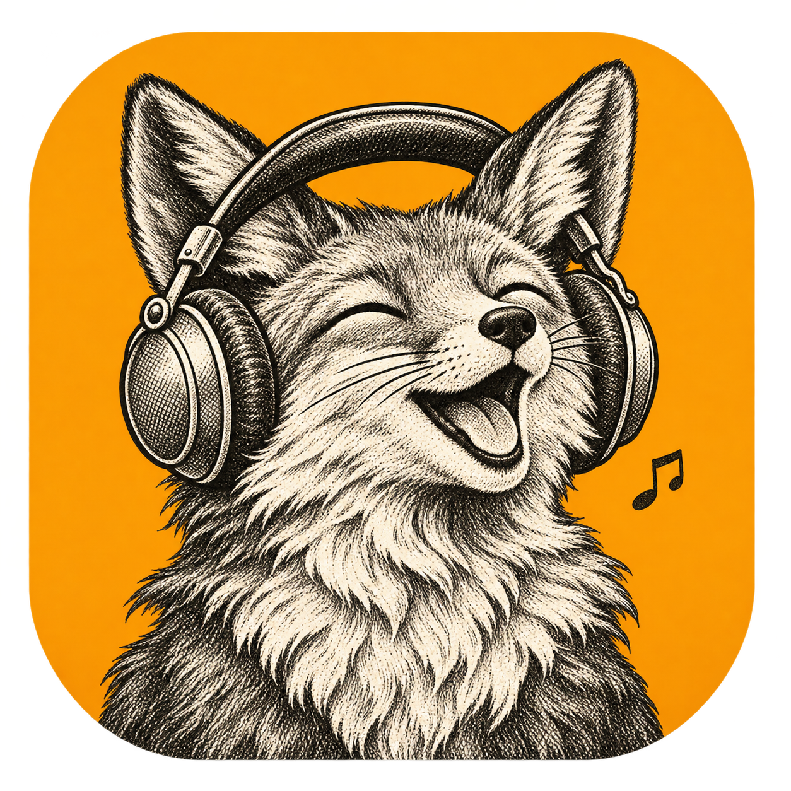
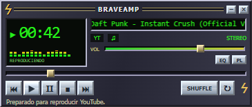
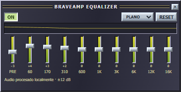
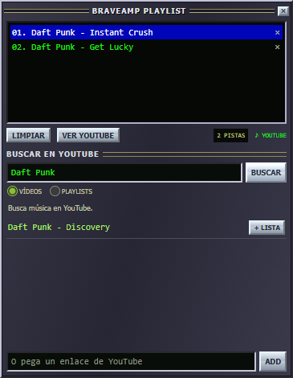
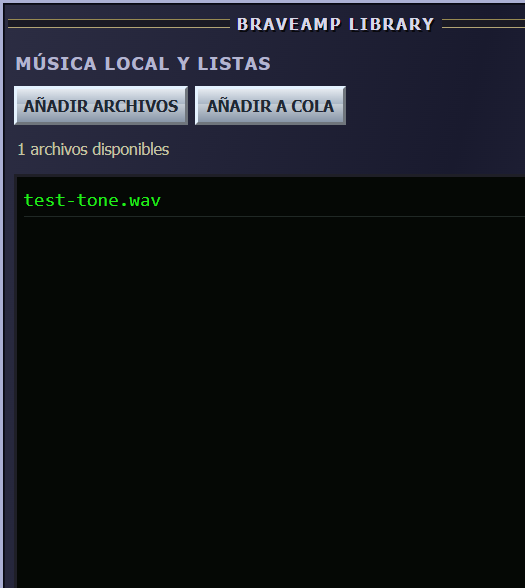

# MusicCraft

<p align="center"></p>

MusicCraft es un reproductor experimental para Windows, inspirado en los reproductores clásicos como Winamp. Combina una interfaz con ventanas acoplables, música local y reproducción de YouTube en una aplicación de escritorio escrita en Rust.

> **Estado:** prototipo en desarrollo. No está afiliada a ArtCraft, Winamp, Brave ni YouTube.

## Descargar

### Windows x64

[**Descargar MusicCraft.exe**](https://github.com/AdolfoCasMar/MusicCraft/releases/download/v0.8.1/MusicCraft.exe) · [Descargar ZIP con licencias y documentación](https://github.com/AdolfoCasMar/MusicCraft/releases/download/v0.8.1/MusicCraft-0.8.1-windows-x64.zip) · [Todas las versiones](https://github.com/AdolfoCasMar/MusicCraft/releases)

La versión es experimental y requiere Windows de 64 bits y Microsoft Edge WebView2 Runtime.

Linux y macOS todavía no son compatibles: la adaptación de ventanas, navegador y filtrado está pendiente. Los paquetes para estos sistemas aún no están disponibles.

## Funciones

- Ventanas para el reproductor, el ecualizador, la cola y la biblioteca, que se pueden mover, acoplar y plegar.
- Búsqueda de vídeos y playlists de YouTube y gestión de una cola de reproducción.
- Reproducción de archivos de audio locales compatibles con el sistema.
- Ecualizador para archivos locales y fuentes compatibles de YouTube.
- Listas guardadas de vídeos de YouTube.
- Navegador WebView2 integrado con el motor `adblock-rust` y reglas de filtrado incluidas. No utiliza el navegador Brave completo y el filtrado de anuncios no está garantizado.

## Capturas

Imágenes de pruebas anteriores al cambio de nombre: muestran BraveAmp y algunos controles pueden diferir de la versión actual.

| Reproductor | Ecualizador |
| --- | --- |
|  |  |

| Cola y búsqueda | Biblioteca local |
| --- | --- |
|  |  |

## Requisitos y compilación

Se necesita Windows, el entorno de desarrollo de Rust, las herramientas de compilación de C++ para Visual Studio y Microsoft Edge WebView2 Runtime. Desde una consola de desarrollo de Visual Studio, en la carpeta del proyecto:

```powershell
cargo build --release
```

El ejecutable se genera en `target/release/musiccraft.exe`. Para ejecutar las pruebas:

```powershell
cargo test
```

## Limitaciones conocidas

- YouTube puede solicitar una elección de cookies o una interacción antes de reproducir. El inicio de la primera canción después de una búsqueda necesita más pruebas.
- El comportamiento y la disponibilidad de vídeos pueden cambiar. El ecualizador de YouTube depende de que la fuente de audio sea compatible.
- Las listas largas pueden importarse parcialmente. Las listas privadas o restringidas pueden requerir iniciar sesión.
- La cola no se conserva al cerrar; los archivos locales no se incluyen en las listas guardadas.
- Las listas de filtros incluidas son una instantánea y no se actualizan automáticamente.
- El icono del zorro es una propuesta visual incluida en el repositorio; aún no sustituye al icono del ejecutable.

## Licencias y componentes de terceros

El código propio se ofrece con doble licencia **MIT o Apache 2.0**, a elección de quien lo utilice, como en el repositorio de SoundCraft. Consulta [LICENSE-MIT](LICENSE-MIT) y [LICENSE-APACHE](LICENSE-APACHE).

El proyecto utiliza bibliotecas y listas de filtros de terceros, cada una con sus propias condiciones. `LICENCIA-ADBLOCK.txt` contiene la licencia MPL-2.0 de adblock-rust; los encabezados de las listas incluidas en `browser/filters/` identifican sus respectivos proyectos y licencias. Antes de redistribuir o reutilizar componentes, revisa sus condiciones y las de sus dependencias.
